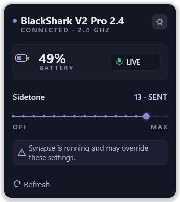

# windows-headset-control

Control your Razer BlackShark V3 Pro or V2 Pro headset from the Windows tray, without
running Synapse.

 

Battery, microphone mute and sidetone on both headsets, plus game/chat balance and noise
cancellation on the V3 Pro, in a panel that opens from the notification area and closes when
you click away. The panel shows only the controls your headset has. It uses around 30 MB of
memory and starts with Windows if you let it.

- Runs as a normal user. No administrator rights.
- Installs no driver and no service.
- Never touches firmware.
- No network access and no telemetry, ever.

## Will it work with my headset?

**Two models, and only these two** — each wireless, via its USB dongle:

| Product | USB vendor id | USB product id | Research record |
| --- | --- | --- | --- |
| Razer BlackShark V3 Pro | `0x1532` | `0x101B` | [`device-research.md`](docs/device-research.md) |
| Razer BlackShark V2 Pro | `0x1532` | `0x0555` | [`device-research-blackshark-v2-pro.md`](docs/device-research-blackshark-v2-pro.md) |

They don't do the same things, and the tray and `headsetctl` offer each one only what it
was observed doing:

| | V3 Pro | V2 Pro |
| --- | --- | --- |
| Battery, link state, hardware mic mute | yes | yes |
| Sidetone | set and read back | set; **cannot be read back** |
| Game/chat balance, noise cancellation | yes | — |
| Power-saving timeout, do not disturb, mic EQ mode | — | `headsetctl` only |

Neither model needs Synapse to be installed or running. The V2 Pro's dongle stays silent
until it has seen the request Synapse opens with, so the tray and `headsetctl` send that
same request, byte for byte, whenever they connect.

They also look different to Windows. The V3 Pro's dongle presents two playback devices, a
game channel and a chat channel. The V2 Pro's presents one, plus its microphone, both
named **Wireless Headset**.

Other products **are not supported**, including other BlackShark models. This talks to the
headset in a language worked out by watching it, not from documentation, so a different
product id is a different device until somebody does that work again.

Not sure what you have? Install it and run `headsetctl list --vendor-id 0x1532`. If that
prints nothing, this can't talk to your headset.

## Install

Download the setup executable and run it. It installs for you only, adds a Start menu entry,
and offers to start with Windows.

| Headset | Release |
| --- | --- |
| V3 Pro | **[Latest upstream release](https://github.com/cunningorb/windows-headset-control/releases/latest)** |
| V2 Pro | **[v0.2.0-alpha.4-v2pro.1](https://github.com/m0n0rail/windows-headset-control/releases/tag/v0.2.0-alpha.4-v2pro.1)**, a pre-release from the fork that added it; it supports the V3 Pro too |

V2 Pro support is not in an upstream release yet. You can also build from source (see
[Building from source](#building-from-source)).

**Windows will warn you.** The installer isn't code-signed, so SmartScreen shows "Windows
protected your PC". Choose **More info**, then **Run anyway**.

To remove it: Settings → Installed apps → Headset Tray → Uninstall.

## Using it

Click the tray icon to open the panel.

**Battery and microphone** are shown at the top. The mic reads `MUTED` if *either* the
headset's own switch or Windows is muting you, because either one silences you — clicking
it toggles the Windows side, since no software can move a physical switch.

**Sidetone** (0–15) is how much of your own voice you hear. Drag the slider and let go, and
the change is sent once.

On the **V3 Pro**, the same slider also drives **game/chat balance** (0–20), which mixes the
headset's two audio channels; the button above it switches between the two. **Noise control**
is off, ANC, or ambient.


ANC has four levels. Ambient has none — so the level track goes quiet in that mode, but
keeps showing where ANC will land when you switch back, because the headset remembers.

On the **V2 Pro**, the slider is sidetone only. The headset has no game/chat balance and no
noise control, and it never reports its sidetone level, so after you set one the panel shows
it as `SENT`. Its other settings (power saving, do not disturb, mic EQ mode) are in
`headsetctl`.

**Nothing on screen is a guess.** A value the headset refuses shows as `--`, never as a
number. Losing the wireless link clears the readings rather than leaving stale ones up. And
after every change, the tray asks the headset what it actually holds — so if it disagrees
with what you asked for, you see the truth. Where the headset can't be asked, as with the
V2 Pro's sidetone, the value is marked `SENT` rather than shown as confirmed.

Right-click the icon for Refresh and Exit. The gear opens settings: start with Windows, and
whether to warn you when Synapse is running (it can fight this app for the same settings).

**Switch output when off** moves Windows' sound to another device when the
headset goes quiet, and puts it back when the headset returns. Turn it on in settings and
pick the device under **Play through** — your speakers, usually. It's off until you do
both.

Holding the power button is what turns the headset off, and that's what this reacts to.
The headset reports that its link dropped, not *why*, so an auto-sleep or walking out of
range looks the same and will also move your sound. Brief dropouts won't: nothing moves
until the link has held its new state for a couple of seconds.

It puts you back exactly where you were, not on a guess. The V3 Pro's dongle presents two
playback devices (Game and Chat), and only you know which one you were using. If the tray
is closed or restarted while your headset is off, it still remembers what it owes you.

Windows offers no supported way for a program to change the default playback device, so
this uses the same undocumented interface every audio switcher uses. If it ever stops
working, nothing moves and you're left where you were.
[`docs/undocumented-apis.md`](docs/undocumented-apis.md) is the full record.

**When it doesn't move your sound, it says so.** You get a notification the first time,
and the reason stays on the **Switch output when off** row in settings until it works
again. For the full picture — which device is chosen, which one you're owed a move back to,
and what would happen right now — run:

```powershell
headset-tray.exe --explain-output
```

It only reads; it won't move anything.

**Split game and chat** is a separate switch, off by default, for the V3 Pro. That headset
shows up in Windows as two playback devices — a game channel and a chat channel — and Windows keeps a
separate default for calls, so the two are there to be used for different things. Turn it
on, pick a **Game channel** and a **Chat channel**, and whenever the headset powers on your
ordinary sound goes to the first and your calls to the second. Leave it off and the tray
won't touch which device your calls use. The V2 Pro has a single playback device, so
there is nothing to split.

The panel **follows your Windows light or dark setting** by default. **Appearance** in
settings overrides that — auto, dark, or light. If you use Windows high contrast, it wins
over all three.

## Good to know

It's **alpha**. It works on its contributors' hardware and is covered by a few hundred
tests, but it speaks a reconstructed protocol and has been used on one headset of each
model.

It sends vendor-specific commands to hardware. It performs no firmware access of any kind,
and every command it can send was observed being sent by Razer's own software — but no
warranty is offered. Running it may void your hardware warranty.

Some things you might expect are **not** here, because they aren't the headset's to
control: volume and software mic mute are handled by Windows, and Synapse's audio
enhancements (bass boost, voice clarity, and so on) are processed on your PC by THX rather
than on the headset. There is nothing for this app to send. So with Synapse closed your
headset may sound different, or quieter, than it does with Synapse running: that
processing simply isn't happening.

## Command line

`headsetctl` ships alongside the tray. Every command takes `--json`, and
`--include-sensitive` to reveal device paths (redacted by default).

```
> headsetctl get battery
battery: 49
> headsetctl set sidetone 7
sidetone: 7
> headsetctl noise                  # V3 Pro
noise-cancellation: anc level 4
> headsetctl noise --level 2        # keeps the current mode
noise-cancellation: anc level 2
> headsetctl noise --mode ambient   # ambient has no level; the ANC level is retained
noise-cancellation: ambient (anc level 2)
> headsetctl set power-saving 30    # V2 Pro: off (0) or 15–60 minutes
power-saving: 30
```

Which names `get` and `set` accept depends on the headset:

| | Names |
| --- | --- |
| Both | `link`, `battery`, `sidetone` (set only on the V2 Pro), `mic-mute` (read on the V3 Pro; reported as an event on the V2 Pro) |
| V3 Pro | `game-chat`, `slider-function`, `noise-cancellation` (and the `noise` command) |
| V2 Pro | `power-saving` (0 = off, or 15–60 minutes), `do-not-disturb`, `mic-eq`; `eq-preset` and `eq-bank` can be read but not set |

Asking for a name the connected headset doesn't have is refused with a message saying so,
and no request for it is sent.

| Command | Writes to the device |
| --- | --- |
| `list`, `inspect`, `probe`, `watch` | no |
| `get <name>` | sends a read request |
| `set <name> <value>` | yes |
| `noise` | reads; writes only when given `--mode` or `--level` |
| `param get/set <id>` | yes, allowlisted identifiers only |

`get` reports `unavailable` rather than a number when the headset refuses a read — which is
what the V3 Pro does when it's switched off. (The V2 Pro's dongle doesn't answer at all
while its headset is off, so there you get no response.) `set` re-reads afterwards and
tells you what the device actually holds, because a write being acknowledged is not
evidence it took effect. Where no read of a setting was ever observed, it says the value is
unconfirmed instead.

`list` enumerates every HID collection on the machine and names the best control candidate.
`inspect` opens one with no I/O rights and prints its report descriptor. `probe` listens for
an unsolicited report without sending anything; silence is a normal result, since the device
only speaks when something changes.

```
> headsetctl param get 0x2c        # observed but unidentified; no meaning is claimed
0x2c: 0f
```

## How it works

The headset speaks a proprietary HID protocol with no public documentation. This project
worked it out by capturing Razer's own software driving the hardware.
[`docs/device-research.md`](docs/device-research.md) (V3 Pro) and
[`docs/device-research-blackshark-v2-pro.md`](docs/device-research-blackshark-v2-pro.md)
record the evidence for every byte: what was sent, what came back, under what conditions.
The two models share no assumptions; each was worked out from its own captures.

**The project can only send identifiers it has actually seen on the wire.** They live in
allowlists in `headset-protocol`, which cannot encode anything else — so a guessed or
brute-forced command has no path to your device from anywhere in the codebase. Observed
parameters whose meaning was never established stay deliberately unnamed rather than being
given plausible-sounding labels.

No code, comments, or command tables were taken from any other project.
[`docs/clean-room-notes.md`](docs/clean-room-notes.md) records what was consulted and on
what terms, including a hypothesis that turned out to be wrong.

Further reading: [`docs/architecture.md`](docs/architecture.md) for how the crates fit
together, [`docs/threat-model.md`](docs/threat-model.md) for the security posture, and
[`docs/history/`](docs/history/) for the design record.

## Building from source

Windows only, and the toolchain requirements are more specific than usual — see
[`CONTRIBUTING.md`](CONTRIBUTING.md) before you start.

```powershell
.\build-installer.ps1        # produces dist\HeadsetTray-<version>-setup.exe
```

Or put a build in place without packaging it:

```powershell
cargo build --release
.\target\release\headset-tray.exe --install
```

Contributions are welcome; [`CONTRIBUTING.md`](CONTRIBUTING.md) explains the rules that
keep the protocol work honest, and there are a few of them.

## Non-affiliation

This is an unofficial community interoperability utility. It is not affiliated with,
authorized by, endorsed by, or sponsored by Razer Inc. or any other manufacturer. Product
names are used only to describe hardware compatibility.

Razer, BlackShark, Synapse, and THX are trademarks of their respective owners. They are used
here only to identify the hardware this utility interoperates with. This project's licence
grants no rights in any trademark.

## Licence

Licensed under either of

- Apache License, Version 2.0 ([`LICENSE-APACHE`](LICENSE-APACHE) or
  <https://www.apache.org/licenses/LICENSE-2.0>)
- MIT licence ([`LICENSE-MIT`](LICENSE-MIT) or <https://opensource.org/licenses/MIT>)

at your option.

Unless you explicitly state otherwise, any contribution intentionally submitted for
inclusion in the work by you, as defined in the Apache-2.0 licence, shall be dual licensed
as above, without any additional terms or conditions.
